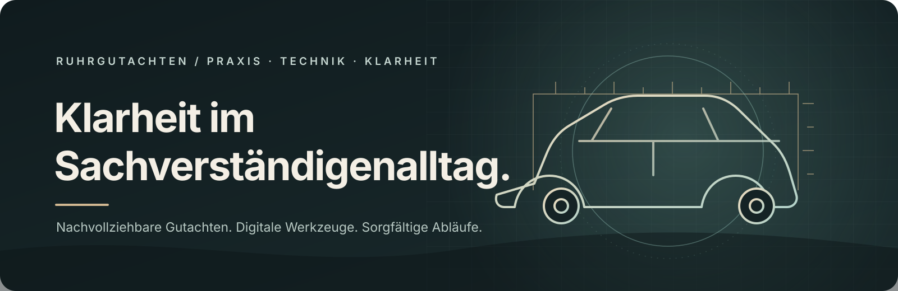

  

<h1 align="center">Digitale Werkzeuge für nachvollziehbare Kfz-Gutachten</h1>

  Ruhrgutachten verbindet Kfz-Sachverständigenwesen mit sorgfältiger Dokumentation und praxistauglicher Automatisierung.

## Woran wir arbeiten

- **Gutachtenpraxis** — Informationen und Arbeitsschritte so ordnen, dass Ergebnisse nachvollziehbar bleiben.
- **Digitale Abläufe** — wiederkehrende Aufgaben mit passenden Werkzeugen übersichtlicher gestalten.
- **Technische Entwicklung** — Anwendungen, Integrationen und Oberflächen für konkrete Arbeitsabläufe bauen.
- **Prüfung und Dokumentation** — Funktionsstände, Grenzen und offene Punkte sichtbar halten.

## Haltung

Ein hilfreiches Werkzeug macht den nächsten Arbeitsschritt klarer. Es zeigt, woher Informationen kommen, was tatsächlich geprüft wurde und wo eine fachliche Entscheidung erforderlich bleibt.

Dieses Profil bündelt ausgewählte Arbeit von Ruhrgutachten. Einige Repositories sind private Arbeitsprojekte und daher nicht öffentlich zugänglich.
